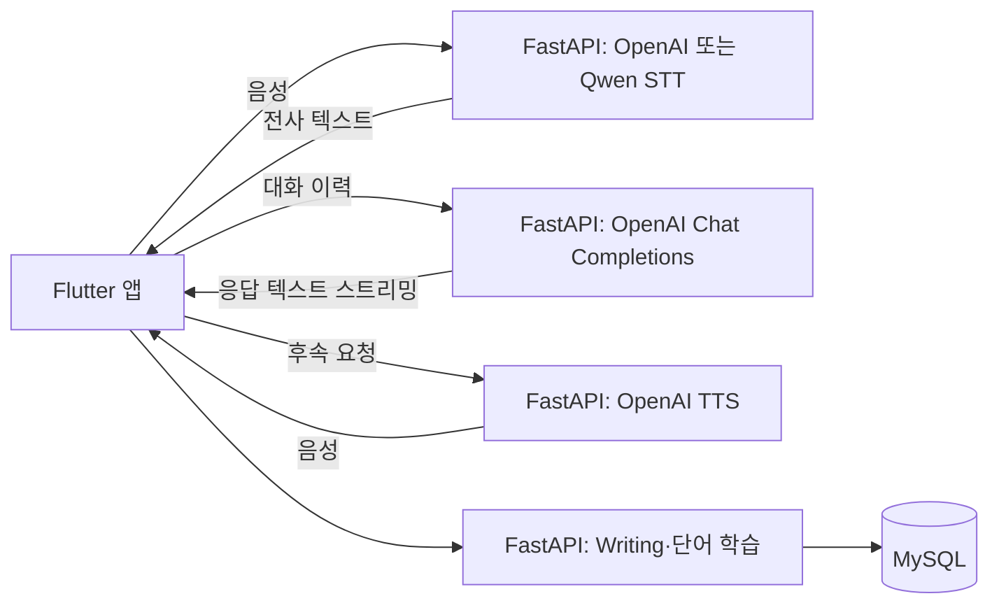

# Sprout English

**AI 기반 개인화 영어 학습 시스템** — 말하기, 상황별 대화, 작문, 단어 복습을 하나의 Flutter 앱에서 연습하는 캡스톤 디자인 졸업작품입니다. FastAPI 서버에 음성 인식(STT), 대화 생성, 음성 합성(TTS)을 연결했습니다.

> 남서울대학교 지능정보통신공학과 · 3인 팀 · 학과 졸업작품 평가 **22개 팀 중 대상**

| 항목 | 내용 |
| --- | --- |
| 기간 | 2025.09 ~ 2026.06 · 실제 개발 약 5개월 |
| 본인 역할 | 팀장, 주제·기능 기획, 역할·일정 조율, 음성 AI 연동, 주요 UI/UX, 전체 통합과 시연·발표 |
| 실행 형태 | 로컬 FastAPI 서버와 Flutter 앱을 연결하는 개발·시연 환경 |
| 구현 방식 | 팀 공동 개발, AI 코딩 도구 적극 활용 |

역할·기간·수상은 팀장 제공 정보입니다. 공식 수상명과 증빙 자료는 공개 범위를 확인한 뒤 추가할 예정입니다.

## 시연 영상

졸업작품 발표회 때 제작한 영상을 시연 자료로 활용합니다.

| 자료 | 상태 |
| --- | --- |
| 졸업작품 발표회 시연 영상 | [YouTube에서 시연 영상 보기](https://youtu.be/xwOvsRPu68I) |

## 주요 기능

아래는 화면·API·서버 소스에서 확인한 구현 범위입니다. 실제 외부 API와 연결한 전체 기능 검증 결과와는 구분합니다.

| 기능 | 구현 내용 | 관련 코드 |
| --- | --- | --- |
| 영어 프리토킹 | 음성 전사, AI 응답 스트리밍 표시, TTS 재생, 번역 | [대화 화면](lib/screens/push_to_talk_freetalk_screen_exact.dart), [서버](server/app/main.py), [실시간 전사](server/app/realtime_speech.py) |
| 롤플레이 | 상황·난이도 선택 후 역할에 맞는 대화 | [대화 화면](lib/screens/roleplay_session_screen_exact.dart), [API](lib/feature/roleplay/roleplay_api.dart), [서비스](server/app/services/roleplay.py) |
| TOEIC Writing 3유형 | 사진 묘사, 이메일 응답, 의견 에세이의 문제·답안·평가 | [학습 화면](lib/feature/writing/toeic_writing_page.dart), [라우터](server/app/routers/writing.py) |
| 문법 검사 | 입력 문장의 교정 결과와 피드백 | [화면](lib/screens/grammar_check_screen.dart), [결과 처리](lib/screens/writing_assist_service.dart) |
| 단어 학습 | 단어 카드, 객관식 시험, SRS 기반 복습 | [화면](lib/feature/vocab/vocab_page.dart), [복습 계산](server/app/services/vocab_srs.py) |

**TOEIC Part 5 객관식 생성·채점은 미완성입니다.** 관련 코드가 남아 있지만 완성 기능에 포함하지 않습니다. 단어 학습의 객관식 시험과는 별개입니다.

## 기술 구성과 처리 흐름

| 영역 | 기술 및 적용 범위 |
| --- | --- |
| 앱 | Flutter/Dart, Dio, `record`, `just_audio`, `web_socket_channel` |
| 서버 | Python, FastAPI, Uvicorn |
| AI | OpenAI STT·Chat Completions·TTS API, Qwen3-ASR 사전학습 모델 기반 로컬 STT |
| 데이터 | MySQL, SQLAlchemy Async, 파일 기반 벡터 저장소 |
| 별도 앱 진입점 | Riverpod·GoRouter (`main_frontend*.dart`) |

기본 앱 `lib/main.dart`는 `MaterialApp`과 `Navigator`를 사용합니다. Riverpod·GoRouter를 기본 앱 전체의 구조로 설명하지 않습니다.



프리토킹은 `WS /speech/realtime`으로 음성을 보내고, `WS /chat/stream`으로 받은 응답 조각을 먼저 화면에 표시합니다. 응답 텍스트 완료 후 TTS를 요청하며 번역도 후속 처리합니다. 음성 합성 완료가 첫 텍스트 표시를 막지 않도록 처리 순서를 구성했습니다. 응답 속도 개선 수치는 동일 조건에서 검증되지 않아 제시하지 않습니다.

Qwen 모드는 사전학습된 `Qwen/Qwen3-ASR-1.7B`를 로컬 추론에 적용한 것입니다. **모델 학습·파인튜닝은 수행하지 않았습니다.** 로컬 STT를 선택해도 대화 생성·TTS·번역 등에는 OpenAI API가 필요합니다. 프리토킹의 로컬 전사는 음성을 버퍼링한 뒤 처리합니다.

## 본인 담당 범위와 협업

| 영역 | 본인이 주도하거나 참여한 범위 |
| --- | --- |
| 팀장·기획 | 주제·기능 기획, 역할 분담, 일정 조율, 사용자 흐름 결정 |
| 음성 AI | OpenAI 음성 API와 Qwen 로컬 STT 연동, 대화 응답 표시 흐름 구성 |
| UI/UX | 주요 Flutter 화면 구성과 기능 연결 |
| 전체 통합 | 팀원 기능 통합, 오류 확인·수정, 시연·발표 준비 |

팀원도 기능 개발을 담당했습니다. 위 목록은 팀 전체 코드의 단독 개발을 의미하지 않습니다. 기존 초안에 기재된 채점·상세 피드백, 서버 평가·저장, 일부 상태관리·통신 기능 등의 개인별 세부 작성 범위는 팀원과 확인이 필요합니다. 기존 개발 시점의 커밋 이력이 없어 파일별 기여를 Git으로 입증할 수 없습니다.

개발 과정에서 AI 코딩 도구를 적극 활용해 코드 초안, 오류 원인, 구현 방향을 검토했습니다. 본인은 요구사항과 화면 흐름을 정하고 생성 코드의 검토·수정, 연동·디버깅, 기능 통합에 참여했습니다.

## 코드 구조

```text
lib/
  main.dart                         # 기본 앱
  main_frontend.dart                # 별도 Riverpod·GoRouter 앱
  main_frontend_local_stt.dart       # 로컬 STT 설정용 앱
  screens/                          # 주요 화면
  feature/                          # 기능별 화면·API·모델
  core/                             # 서버 주소·오디오·설정·프로필·학습 기록
server/
  app/main.py                       # 기본 서버 (OpenAI STT)
  app/main_local_stt.py              # Qwen 로컬 STT 서버
  app/local_stt_switch/              # 모델 로딩·전사·워밍업
  app/routers/                      # Writing 등 API
  app/services/                     # 대화·평가·복습 로직
  dictionaries/                     # 단어·작문 문제 자료
  tests/                            # Python 단위 테스트
scripts/                            # 기존 실행 보조 스크립트
test/                               # Flutter 테스트
docs/                               # 로컬 STT 안내·공개 전 확인 사항
```

## 실행 방법

선언된 환경은 Python `>=3.10`, Dart SDK `^3.9.2`를 지원하는 Flutter입니다. 다음은 macOS/Linux 셸 기준이며 Windows 절차는 검증하지 않았습니다. MySQL 서버·빈 데이터베이스·전용 계정, 마이크와 마이크 접근 권한을 준비해 주세요.

### 1. 서버 설치와 환경변수

프로젝트 루트에서 실행합니다. 기존 가상환경을 재사용할 경우 생성 단계는 생략합니다.

```bash
cd server
uv venv --python 3.10
uv pip install --python .venv/bin/python -r requirements.txt
# .env가 없을 때만 복사합니다. 기존 설정을 덮어쓰지 않습니다.
[ -f .env ] || cp .env.example .env
```

`server/.env.example`의 활성 값은 모두 비어 있습니다. `server/.env`에서 다음 값을 채워 주세요.

| 변수 | 설정 내용 |
| --- | --- |
| `OPENAI_API_KEY` | 본인 계정의 API 키. 앱에 넣지 않고 서버에서만 사용합니다. |
| `DB_HOST`, `DB_PORT` | MySQL 주소와 포트 (로컬 구성 시 보통 `127.0.0.1`, `3306`) |
| `DB_NAME`, `DB_USER`, `DB_PASSWORD` | 미리 생성한 DB와 전용 계정의 접속 정보 |
| `OPENAI_WHISPER_MODEL` | 사용하는 OpenAI 전사 모델 ID. OpenAI STT 모드에서는 필수입니다. |

빈 `DB_PORT`는 정수 설정 오류를 발생시키므로 반드시 채워 주세요. 서버가 테이블 생성을 시도하지만 DB 자체와 계정은 생성하지 않습니다. 기존 개인정보가 포함된 SQL 스냅샷을 실행 환경 준비에 사용하지 않습니다.

공용 LLM의 `LLM_MODE` 기본값은 `openai`이며, `mock`이면 실제 LLM을 사용하지 않습니다. 선택 모델의 코드 기본값은 `LLM_MODEL=gpt-4o-mini`, `FREE_TALK_CHAT_MODEL=gpt-5-nano`, `OPENAI_TTS_MODEL=gpt-4o-mini-tts`, `OPENAI_TRANSLATE_MODEL=gpt-4o-mini`입니다. 계정에서 사용할 수 있는 모델을 확인해 주세요. 기능별 모델 선택은 서로 다르며 모든 AI 기능이 하나의 설정을 공유하지는 않습니다.

### 2. 서버 실행

다음 중 한 모드만 `server/`에서 실행합니다. `uv --env-file`로 환경변수를 먼저 전달해 모듈별 설정 읽기 방식을 맞춥니다.

OpenAI STT 모드:

```bash
uv run --no-project --env-file .env .venv/bin/python -m uvicorn \
  app.main:app --host 127.0.0.1 --port 8000
```

Qwen 로컬 STT 모드:

```bash
uv pip install --python .venv/bin/python -r requirements-local-stt.txt
LOCAL_STT_QWEN_DEVICE_MAP=cpu LOCAL_STT_QWEN_DTYPE=float32 \
LOCAL_STT_QWEN_ISOLATE_PROCESS=1 \
uv run --no-project --env-file .env .venv/bin/python -m uvicorn \
  app.main_local_stt:app --host 127.0.0.1 --port 8000
```

Qwen은 첫 실행 시 모델 다운로드와 워밍업이 필요할 수 있습니다. 장치·메모리·추론 설정은 [로컬 STT 안내](docs/local_stt_switch.md)를 참고해 주세요. 위 명령은 기존 서버 프로세스를 종료하지 않습니다.

API 문서는 실행 후 `http://127.0.0.1:8000/docs`에 있습니다. `/healthz` 성공만으로 DB·AI 기능 전체가 검증되지는 않습니다.

### 3. Flutter 앱 실행

새 터미널의 프로젝트 루트에서 실행합니다.

```bash
flutter pub get
flutter run -t lib/main.dart \
  --dart-define=ENGLISH_AI_SERVER_BASE_URL=http://127.0.0.1:8000
```

Android 에뮬레이터는 서버 주소를 `http://10.0.2.2:8000`으로 지정합니다. Android USB 실기기는 `adb reverse tcp:8000 tcp:8000`을 설정하면 위 루프백 주소를 사용할 수 있습니다. 그 외 네트워크 연결은 장치별 서버 접근 설정이 필요합니다. 로컬 STT 설정 전용 화면은 `-t lib/main_frontend_local_stt.dart`로 실행합니다.

## 테스트와 검증 범위

```bash
# 프로젝트 루트: 의존성을 받은 뒤 실행
flutter test --no-pub

# server/ 디렉터리
PYTHONDONTWRITEBYTECODE=1 .venv/bin/python -B -m unittest discover \
  -s tests -p 'test_*.py' -v
```

2026-10-19의 로컬 검증 결과입니다. 기존 환경을 사용했으며 깨끗한 환경에서 재설치한 결과는 아닙니다.

| 검증 | 결과와 범위 |
| --- | --- |
| 기존 서버 단위 테스트 | 17개 통과: LLM 분기·mock 호출, 규칙 기반 롤플레이, Writing 문제 자료, 단어 SRS 일부 |
| 공개 준비 회귀 테스트 | 3개 추가·통과: `.env` 절대경로, 공용 환경변수 허용·빈 기본 비밀번호, 빈 저장 폴더 생성. 서버 합계 20개 통과 |
| Flutter 테스트 | 36개 통과: 화면 이동·설정·프로필·통계·작문 결과 처리 등 |
| 미실행 | 실제 OpenAI 호출, MySQL 연동·마이그레이션, Qwen 추론·성능 측정, 실제 녹음·재생, 플랫폼별 앱 빌드·실기기 시연, 새 환경 전체 설치 |

최종 재검증 결과와 공개 전 남은 항목은 [공개 준비 기록](docs/PUBLICATION_REVIEW.md)에 정리했습니다.

## 현재 한계와 공개 상태

- 로컬 개발·시연 프로젝트입니다. 인증·접근통제, 전체 기능 통합과 운영 배포 검증이 남아 있습니다. 서버를 외부에 그대로 노출하지 않습니다.
- 일부 API는 실패 시 개발용 대체 응답을 반환합니다. 응답 존재만으로 실제 AI 호출 성공을 판단할 수 없습니다.
- 기본 CORS 허용과 녹음 정적 제공 경로(`/static`) 등이 있어 개인정보 처리·배포 설계 보완이 필요합니다.
- 레거시 진입점·마이그레이션·DB 보조 스크립트와 의존성 선언 간 차이가 남아 있습니다. 현재 실행 기준은 위 서버 진입점과 `requirements.txt`입니다.
- 팀원 전원의 프로젝트 공개 동의를 받았습니다. 팀원별 세부 기여 범위와 수상 증빙은 추가 확인이 필요합니다. 시연 자료는 위 졸업작품 발표회 영상 링크에서 확인할 수 있습니다.
- 자료의 출처·재배포 권한 검토는 이번 공개 준비 범위에서 생략했습니다. 프로젝트 라이선스는 별도로 지정하지 않았습니다.
- 환경변수·녹음·DB 스냅샷·백업 등은 `.gitignore`로 제외했습니다. 무시 규칙은 이미 만들어진 Git 객체를 제거하지 않으므로, 공개 준비 기록의 민감정보 조치가 필요합니다.
