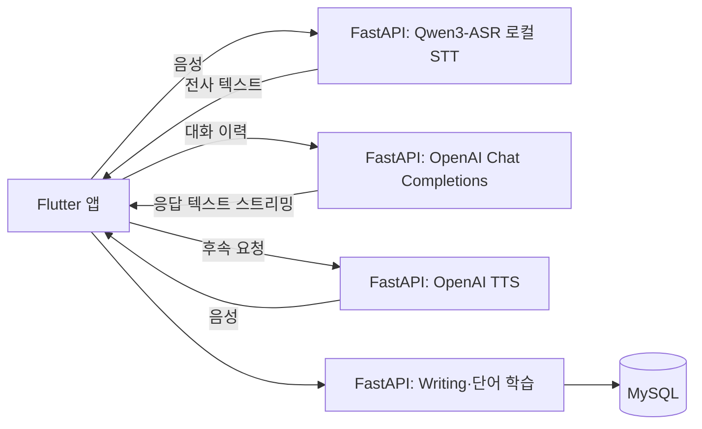

# Sprout English

**AI 기반 개인화 영어 학습 시스템** — 말하기, 상황별 대화, 작문, 단어 복습을 하나의 Flutter 앱에서 연습하는 캡스톤 디자인 졸업작품입니다. 음성 인식(STT)은 FastAPI 서버에서 실행하는 Qwen3-ASR 로컬 모델로, 대화 생성과 음성 합성(TTS)은 OpenAI API로 처리합니다.

> 남서울대학교 지능정보통신공학과 · 3인 팀 · 학과 졸업작품 평가 **22개 팀 중 대상**

| 항목 | 내용 |
| --- | --- |
| 기간 | 2025.09 ~ 2026.06 · 실제 개발 약 5개월 |
| 본인 역할 | 팀장, 주제·기능 기획, 역할·일정 조율, AI 기능 전반 구현·연동, 주요 UI/UX, 전체 통합과 시연·발표 |
| 실행 형태 | 로컬 FastAPI 서버와 Flutter 앱을 연결하는 개발·시연 환경 |
| 구현 방식 | 팀 공동 개발, AI 코딩 도구 적극 활용 |

역할·기간·수상은 팀장 제공 정보입니다. 공식 수상명과 증빙 자료는 공개 범위를 확인한 뒤 추가할 예정입니다.

## 시연 영상

졸업작품 발표회 시연 영상 · [YouTube](https://youtu.be/xwOvsRPu68I)

## 주요 기능

아래는 화면·API·서버 소스에서 확인한 구현 범위입니다. 실제 외부 API와 연결한 전체 기능 검증 결과와는 구분합니다.

| 기능 | 구현 내용 | 관련 코드 |
| --- | --- | --- |
| 영어 프리토킹 | 음성 전사, AI 응답 스트리밍 표시, TTS 재생, 번역 | [대화 화면](lib/screens/push_to_talk_freetalk_screen_exact.dart), [서버](server/app/main.py), [실시간 전사](server/app/realtime_speech.py), [로컬 STT](server/app/main_local_stt.py) |
| 롤플레이 | 상황·난이도 선택 후 역할에 맞는 대화 | [대화 화면](lib/screens/roleplay_session_screen_exact.dart), [API](lib/feature/roleplay/roleplay_api.dart), [서비스](server/app/services/roleplay.py) |
| TOEIC Writing 3유형 | 사진 묘사, 이메일 응답, 의견 에세이의 문제·답안·평가 | [학습 화면](lib/feature/writing/toeic_writing_page.dart), [라우터](server/app/routers/writing.py) |
| 문법 검사 | 입력 문장의 교정 결과와 피드백 | [화면](lib/screens/grammar_check_screen.dart), [결과 처리](lib/screens/writing_assist_service.dart) |
| 단어 학습 | 단어 카드, 객관식 시험, SRS 기반 복습 | [화면](lib/feature/vocab/vocab_page.dart), [복습 계산](server/app/services/vocab_srs.py) |

## 기술 구성과 처리 흐름

| 영역 | 기술 및 적용 범위 |
| --- | --- |
| 앱 | Flutter/Dart, Dio |
| 서버 | Python, FastAPI, Uvicorn |
| AI | Qwen3-ASR-1.7B 사전학습 모델 기반 로컬 STT, OpenAI Chat Completions·TTS API |
| 데이터 | MySQL, SQLAlchemy Async, 파일 기반 벡터 저장소 |



## 본인 담당 범위와 협업

| 영역 | 본인 담당 범위 |
| --- | --- |
| 팀장·기획 | 주제·기능 기획, 역할 분담, 일정 조율, 사용자 흐름 결정 |
| AI 기능 전반 | 음성 인식·대화 생성·음성 합성·번역·문법 교정·작문 평가 등 AI 기능 전반을 구현하고 연동했습니다. 음성 인식에는 Qwen 로컬 모델을, 대화 생성·음성 합성·번역·평가에는 OpenAI API를 적용하고, 응답 스트리밍과 후속 처리 흐름을 구성했습니다. 초기에 쓰던 OpenAI STT를 Qwen 로컬 모델로 교체해 전사 대기를 2초 이상에서 0.1~0.2초 수준으로 줄였습니다(M3 MacBook Pro, 동일 조건 비교). |
| UI/UX | 주요 Flutter 화면 구성과 기능 연결 |
| 전체 통합 | 팀원 기능 통합, 오류 확인·수정, 시연·발표 준비 |

개발 과정에서 AI 코딩 도구를 적극 활용했습니다. 코드 초안을 작성하고 오류 원인과 구현 방향을 검토하는 데 도움을 받았습니다. 요구사항과 화면 흐름을 정하고 생성 코드를 검토·수정했으며 연동·디버깅과 기능 통합에 참여했습니다.

## 코드 구조

```text
lib/
  main.dart                         # 기본 앱
  main_frontend.dart                # 별도 Riverpod·GoRouter 앱
  main_frontend_local_stt.dart       # 로컬 STT 설정용 앱
  screens/                          # 주요 화면
  feature/                          # 기능별 화면·API·모델
  core/                             # 서버 주소·오디오·설정·프로필·학습 기록
server/
  app/main.py                       # 공용 API (대화·TTS·평가 등)
  app/main_local_stt.py              # 실행 진입점: main.py에 Qwen 로컬 STT 연결
  app/local_stt_switch/              # 모델 로딩·전사·워밍업
  app/routers/                      # Writing 등 API
  app/services/                     # 대화·평가·복습 로직
  dictionaries/                     # 단어·작문 문제 자료
  tests/                            # Python 단위 테스트
scripts/                            # 기존 실행 보조 스크립트
test/                               # Flutter 테스트
docs/                               # 로컬 STT 안내·공개 전 확인 사항
```

## 실행 방법

서버에는 Python `>=3.10`이 필요합니다. 앱은 Dart SDK `^3.9.2`를 지원하는 Flutter 환경에서 실행해 주세요. 다음은 macOS/Linux 셸 기준이며 Windows 절차는 검증하지 않았습니다. MySQL 서버·빈 데이터베이스·전용 계정, 마이크와 마이크 접근 권한을 준비해 주세요.

### 1. 서버 설치와 환경변수

프로젝트 루트에서 실행합니다. 기존 가상환경을 재사용할 경우 생성 단계는 생략합니다.

```bash
cd server
uv venv --python 3.10
uv pip install --python .venv/bin/python -r requirements.txt
# .env가 없을 때만 복사합니다. 기존 설정을 덮어쓰지 않습니다.
[ -f .env ] || cp .env.example .env
```

`server/.env.example`의 활성 값은 모두 비어 있습니다. `server/.env`에서 다음 값을 채워 주세요.

| 변수 | 설정 내용 |
| --- | --- |
| `OPENAI_API_KEY` | 본인 계정의 API 키. 대화·TTS·번역·평가에 쓰며, 앱에 넣지 않고 서버에서만 사용합니다. |
| `DB_HOST`, `DB_PORT` | MySQL 주소와 포트 (로컬 구성 시 보통 `127.0.0.1`, `3306`) |
| `DB_NAME`, `DB_USER`, `DB_PASSWORD` | 미리 생성한 DB와 전용 계정의 접속 정보 |

음성 인식은 로컬 Qwen 모델이 맡으므로 OpenAI 전사 모델 설정(`OPENAI_WHISPER_MODEL`)은 필요하지 않습니다.

빈 `DB_PORT`는 정수 설정 오류를 발생시키므로 반드시 채워 주세요. 서버가 테이블 생성을 시도하지만 DB 자체와 계정은 생성하지 않습니다. 기존 개인정보가 포함된 SQL 스냅샷을 실행 환경 준비에 사용하지 않습니다.

공용 LLM의 `LLM_MODE` 기본값은 `openai`이며, `mock`이면 실제 LLM을 사용하지 않습니다. 선택 모델의 코드 기본값은 `LLM_MODEL=gpt-4o-mini`, `FREE_TALK_CHAT_MODEL=gpt-5-nano`, `OPENAI_TTS_MODEL=gpt-4o-mini-tts`, `OPENAI_TRANSLATE_MODEL=gpt-4o-mini`입니다. 계정에서 사용할 수 있는 모델을 확인해 주세요. 기능별 모델 선택은 서로 다르며 모든 AI 기능이 하나의 설정을 공유하지는 않습니다.

### 2. 서버 실행

`server/`에서 로컬 STT 의존성을 추가로 설치한 뒤 Qwen 로컬 STT 진입점으로 실행합니다. `uv --env-file`로 환경변수를 먼저 전달해 모듈별 설정 읽기 방식을 맞춥니다.

```bash
uv pip install --python .venv/bin/python -r requirements-local-stt.txt
LOCAL_STT_QWEN_DEVICE_MAP=cpu LOCAL_STT_QWEN_DTYPE=float32 \
LOCAL_STT_QWEN_ISOLATE_PROCESS=1 \
uv run --no-project --env-file .env .venv/bin/python -m uvicorn \
  app.main_local_stt:app --host 127.0.0.1 --port 8000
```

Qwen은 첫 실행 시 모델 다운로드가 필요하고, 서버 시작 시 모델을 불러와 워밍업합니다. 장치·메모리·추론 설정은 [로컬 STT 안내](docs/local_stt_switch.md)를 참고해 주세요. 위 명령은 기존 서버 프로세스를 종료하지 않습니다.

`app.main:app`을 단독으로 실행하면 초기 개발에 쓰던 OpenAI STT 경로로 음성을 인식합니다. 이후 전사 대기 시간을 줄이기 위해 Qwen 로컬 모델로 교체했고, 시연과 실행 안내는 Qwen 기준입니다.

API 문서는 실행 후 `http://127.0.0.1:8000/docs`에 있습니다. `/healthz` 성공만으로 DB·AI 기능 전체가 검증되지는 않습니다.

### 3. Flutter 앱 실행

새 터미널의 프로젝트 루트에서 실행합니다.

```bash
flutter pub get
flutter run -t lib/main.dart \
  --dart-define=ENGLISH_AI_SERVER_BASE_URL=http://127.0.0.1:8000
```

Android 에뮬레이터는 서버 주소를 `http://10.0.2.2:8000`으로 지정합니다. Android USB 실기기는 `adb reverse tcp:8000 tcp:8000`을 설정하면 위 루프백 주소를 사용할 수 있습니다. 그 외 네트워크 연결은 장치별 서버 접근 설정이 필요합니다. 로컬 STT 설정 전용 화면은 `-t lib/main_frontend_local_stt.dart`로 실행합니다.
